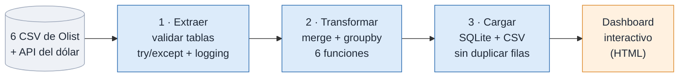

<div align="center">

# Dashboard 360 de Olist

**Pipeline de datos en Python que responde: ¿cómo va el negocio y dónde conviene actuar primero?**


[](Dashboard360/README.md)

</div>

---

Proyecto integrador del curso **DPL1046: Programación en Python y Manipulación de Datos**, Diplomado en Ingeniería de Datos con Python, Universidad de las Américas (UDLA). Profesor: PhD. Juan Manuel Rozas.

**Tema 10:** Dashboard 360 del negocio · **Integrantes:** Favio Jimenez B · Roberto Muñoz Velasco

## Qué hace

Un solo comando (`python pipeline.py`) lee seis tablas del conjunto de datos de Olist (marketplace de Brasil) y una API del dólar, las valida, calcula los indicadores del negocio, guarda los resultados en SQLite y CSV, y genera un **dashboard interactivo** (`salida/dashboard.html`) que se abre solo en el navegador.



## Resultados

| Indicador | Resultado |
|---|---:|
| 📦 Pedidos entregados | **96.478** de 99.441 (97,02 %) |
| 💰 Ventas (precio de productos, sin flete) | **13.221.498,11 BRL** |
| 🧾 Ticket promedio | **137,04 BRL** |
| ⭐ Satisfacción promedio | **4,16** de 5 |
| 🚚 Entregas a tiempo | **93,23 %** |

### 1 · Las categorías que más venden

| Categoría | Ventas (BRL) | |
|---|---:|:---|
| `health_beauty` | 1.233.132 | `█████████████████` |
| `watches_gifts` | 1.166.177 | `█████████████████░` |
| `bed_bath_table` | 1.023.435 | `█████████████████░░░` |
| `sports_leisure` | 954.853 | `████████████████░░░░░` |
| `computers_accessories` | 888.725 | `█████████████░░░░░░` |

### 2 · Más atraso en la entrega, más baja la nota

| Atraso en la entrega | Nota promedio | |
|---|---:|:---|
| A tiempo | 4,29 | `████████████████░░░` |
| 1 a 3 días | 3,29 | `█████████████░░░░░░░` |
| 4 a 10 días | 1,97 | `████████░░░░░░░░░░░░` |
| Más de 10 días | 1,71 | `███████░░░░░░░░░░░░░` |

### 3 · Estados con peor puntualidad

| Estado | Entregas a tiempo | |
|---|---:|:---|
| AL | 78,59 % | `████████████████░░░░` |
| MA | 82,57 % | `█████████████████░░░` |
| SE | 84,78 % | `█████████████████░░░` |
| PI | 86,13 % | `█████████████████░░░` |
| CE | 86,24 % | `█████████████████░░░` |

> **Decisión que permite:** atacar primero los atrasos de más de 10 días (la nota baja de 4,29 a 1,71) y revisar la logística en **AL, MA y SE**, los estados con peor puntualidad.

## Cómo ejecutarlo

Los comandos se ejecutan en Git Bash. Los CSV de Olist **no están en el repositorio**: hay que copiarlos desde el repo del profesor (`diplomado-idsdata-juanmarozas/data/raw/`) a la carpeta `Dashboard360/data/raw/` (el comando de copia está abajo; usa la ruta donde tengas ese repo).

```bash
git clone https://github.com/Favio-Richar/ProyectoDiplomadoPython.git   # descarga el repositorio
cd ProyectoDiplomadoPython/Dashboard360                  # entra a la carpeta del proyecto
py -3.12 -m venv .venv                                   # crea el entorno virtual
source .venv/Scripts/activate                            # activa el entorno
python -m pip install -r requirements.txt                # instala las dependencias
cp .env.example .env                                     # crea la configuración local (URL de la API)
mkdir -p data/raw                                        # crea la carpeta de datos
cp <ruta-del-repo-del-profesor>/data/raw/*.csv data/raw/ # copia los CSV del repo del profesor
python pipeline.py                                       # ejecuta el pipeline completo
pytest -v                                                # ejecuta las 22 pruebas
```

## Calidad del código

- ✅ **22 pruebas con pytest**, al menos 3 por cada función de transformación.
- ✅ **Validación y manejo de errores:** `try/except` y registro con `logging`.
- ✅ **Idempotente:** ejecutarlo dos veces da el mismo resultado, sin duplicar filas.
- ✅ **Sin claves en el código:** la configuración va en `.env`, que no se sube a git.

## Primera vez y cómo traer los cambios del compañero

**Primera vez (aún no tienes el proyecto):** se usa `git clone`, una sola vez, desde la carpeta donde quieras guardarlo (por ejemplo, tu carpeta de usuario `~`). Los comandos de "Cómo ejecutarlo" ya lo incluyen. Esto crea la carpeta `ProyectoDiplomadoPython`.

**Cuando ya tienes el proyecto:** se usa `git pull`, cada vez que el compañero haya subido cambios. Reglas para que funcione:

- **Dónde ejecutarlo:** dentro de la carpeta del repositorio, es decir, en `ProyectoDiplomadoPython/` (la carpeta que contiene `.git`). `Dashboard360/` también sirve porque está dentro, pero la carpeta correcta es la de la raíz.
- **Con qué programa:** Git Bash, abierto en esa carpeta (clic derecho en la carpeta, "Open Git Bash here", o `cd ~/ProyectoDiplomadoPython`).
- **Antes de hacer `git pull`:** conviene que no tengas cambios sin guardar. Revisa con `git status`; si hay archivos modificados, haz primero `git add`, `git commit` y luego `git pull`.
- **Comprobar que funcionó:** `git log --oneline` muestra los últimos cambios y `git status` debe decir `Your branch is up to date with 'origin/main'`.

```bash
cd ~/ProyectoDiplomadoPython      # entra a la carpeta del repositorio (la raíz, donde está .git)
git status                        # revisa que no haya cambios sin guardar
git pull                          # descarga y une los cambios que subió el compañero
git log --oneline                 # confirma los últimos cambios recibidos
```

**El repo del profesor (`diplomado-idsdata-juanmarozas`)** es otro repositorio, aparte de este. Si el profesor actualiza sus datos, se hace `git pull` **dentro de su carpeta** (`cd <ruta-del-repo-del-profesor>`), nunca dentro de la carpeta de este proyecto. Después se vuelve a copiar `data/raw/` como se explica en "Cómo ejecutarlo". Ese repo es solo de lectura: no se modifica ni se sube nada a él.

## Actualizar el repositorio

```bash
git pull                      # descarga y une los cambios de GitHub
git status                    # muestra qué archivos cambiaron
git add .                     # prepara los cambios
git commit -m "Descripción breve del cambio"   # guarda una versión con un mensaje
git push                      # sube los cambios a GitHub
```

## Estructura del repositorio

```text
ProyectoDiplomadoPython/
├── README.md          Este archivo
└── Dashboard360/      Proyecto completo: código, pruebas y README detallado
```
