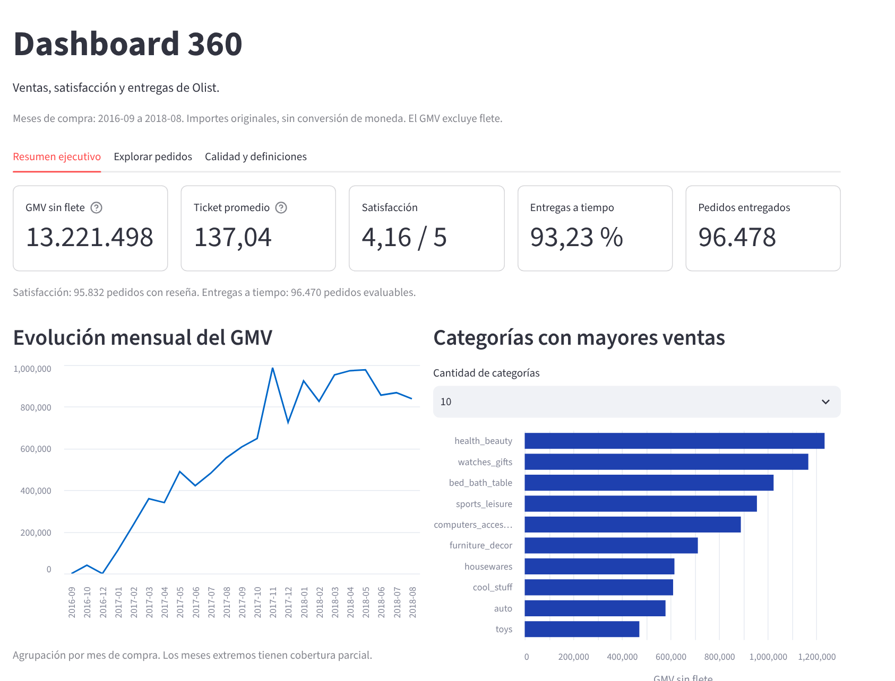
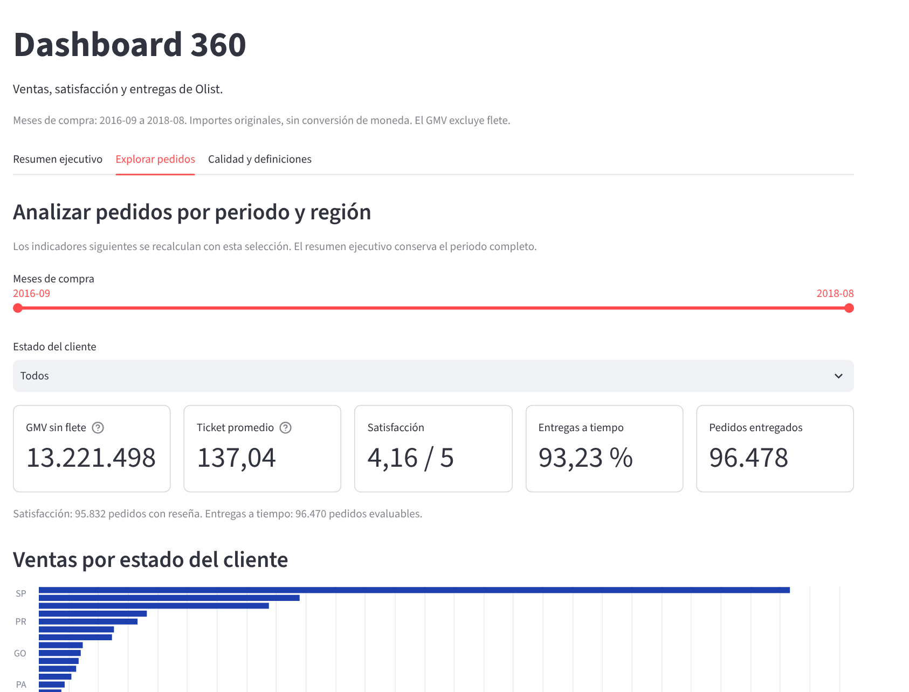
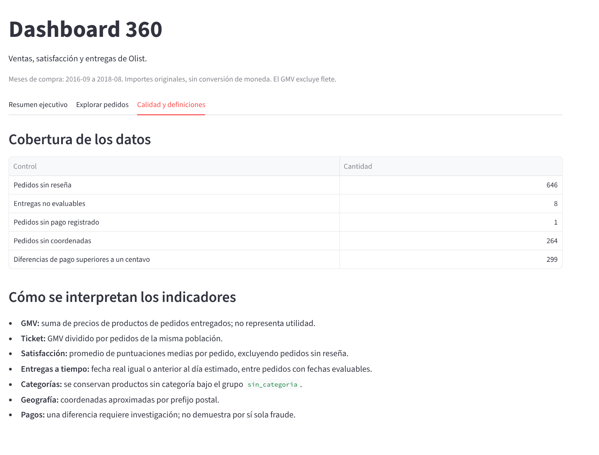

# Dashboard 360 de Olist

Proyecto integrador del curso **DPL1046: Programación en Python y Manipulación de Datos**, Diplomado en Ingeniería de Datos con Python, Universidad de las Américas (UDLA). Profesor: PhD. Juan Manuel Rozas.

**Tema 10:** Dashboard 360 del negocio. **Integrantes:** Favio Jimenez B · Roberto Muñoz Velasco.

Un pipeline de datos en Python que corre en local con un solo comando. Lee las nueve tablas del conjunto de datos de Olist (marketplace de Brasil), las valida, calcula cinco indicadores ejecutivos, guarda los resultados en SQLite y los muestra en un dashboard de Streamlit.

> **Documentación completa del proyecto:** [`Dashboard360/README.md`](Dashboard360/README.md)

## Resultados

| Indicador | Resultado |
|---|---:|
| Pedidos entregados | 96.478 de 99.441 (97,02 %) |
| GMV (precios de productos, sin flete) | 13.221.498,11 |
| Ticket promedio | 137,04 |
| Satisfacción promedio | 4,16 de 5 |
| Entregas a tiempo | 93,23 % |

Los importes están en la moneda original de los datos, sin conversión.

## Vista del dashboard

Resumen ejecutivo:



Exploración por periodo y estado del cliente:



Calidad de los datos y definiciones:



## Tecnologías

Python 3.12 · pandas · SQLite · Streamlit y Altair · pytest · logging

## Cómo ejecutarlo

Los comandos se ejecutan en Git Bash. Los nueve CSV originales del curso no están en el repositorio: se colocan en `Dashboard360/data/raw/`.

```bash
git clone https://github.com/Favio-Richar/ProyectoDiplomadoPython.git   # descarga el repositorio
cd ProyectoDiplomadoPython/Dashboard360                  # entra a la carpeta del proyecto
py -3.12 -m venv .venv                                   # crea el entorno virtual
source .venv/Scripts/activate                            # activa el entorno
python -m pip install -r requirements.txt                # instala las dependencias
mkdir -p data/raw                                        # crea la carpeta de datos (luego copia los 9 CSV)
python pipeline.py                                       # ejecuta el pipeline completo
python -m pytest -v                                      # ejecuta las 9 pruebas
python -m streamlit run dashboard.py                     # abre el dashboard en el navegador
```

## Actualizar el repositorio

```bash
git pull                      # descarga y une los cambios de GitHub
git status                    # muestra qué archivos cambiaron
git add .                     # prepara los cambios
git commit -m "Descripción breve del cambio"   # guarda una versión con un mensaje
git push                      # sube los cambios a GitHub
```

## Estructura del repositorio

```text
ProyectoDiplomadoPython/
├── README.md          Este archivo
└── Dashboard360/      Proyecto completo: código, pruebas, documentación y README detallado
```
